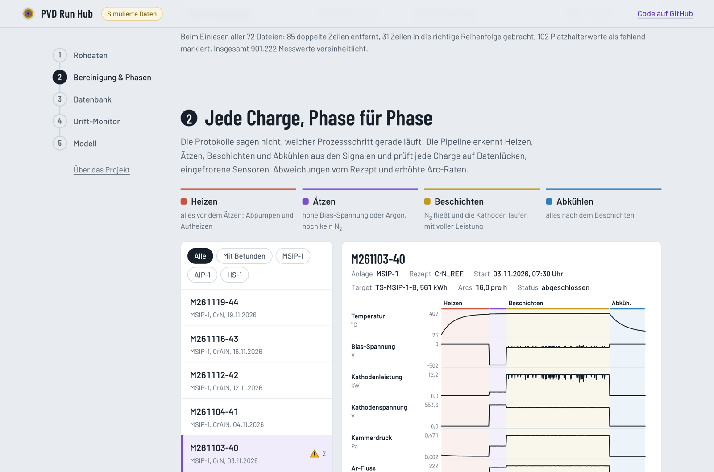
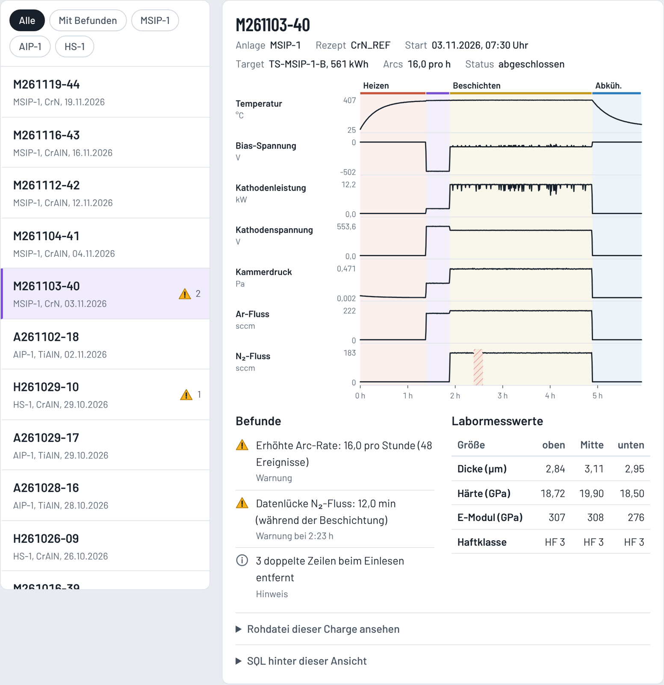

# PVD Run Hub

**Vom Anlagenlog zur Trainingsdatenbank.** Eine Python/SQL-Pipeline, die Prozessprotokolle von
PVD-Beschichtungsanlagen einliest, bereinigt, in Prozessphasen zerlegt, jede Charge mit ihren
Labormesswerten verknüpft und daraus Trainingsdaten für KI-Modelle macht. Dazu ein Drift-Monitor
(Golden-Run-Vergleich) und ein Gauß-Prozess-Modell, das den nächsten sinnvollen Versuch vorschlägt.

> **Alle Daten in diesem Repository sind simuliert.** Anlagen, Rezepte und Messwerte sind erfunden,
> damit die Pipeline etwas Realistisches zu verarbeiten hat. Der Simulator ist kein validiertes
> physikalisches Modell. Code, Datenbankschema und Methoden sind echt.



## Das Problem

Ein PVD-Lauf erzeugt ein Maschinenprotokoll (Bias-Spannung, Kathodenleistung, Druck, Gasflüsse,
Temperatur). Die Schichteigenschaften (Dicke, Härte, E-Modul, Haftung) werden Tage später in anderen
Laboren gemessen und landen in anderen Dateien. Jede Anlage schreibt ihr Protokoll anders. Solange
„diese Prozessparameter“ und „diese Schichteigenschaften“ nicht verlässlich verknüpft sind, kann man
kein Modell trainieren und keinen digitalen Zwilling bauen.

## Was die Pipeline macht

| Schritt | Modul | Was passiert |
|---|---|---|
| 1. Einlesen | `pvdhub/ingest.py` | Drei Exportformate → ein Schema (Einheiten, Zeitzonen, Platzhalterwerte, doppelte und vertauschte Zeilen) |
| 2. Bereinigen | `pvdhub/clean.py` | Einheitliche Zeitbasis, kurze Lücken interpolieren, lange Lücken und eingefrorene Sensoren melden |
| 3. Phasen | `pvdhub/phases.py` | Heizen, Ätzen, Beschichten, Abkühlen allein aus den Signalen erkennen |
| 4. Qualität | `pvdhub/quality.py` | Arc-Rate, Abweichung vom Rezept, abgebrochene Chargen |
| 5. Datenbank | `pvdhub/schema.sql`, `pvdhub/db.py` | SQLite (auf PostgreSQL übertragbar), Rückverfolgbarkeit bis zur Rohdatei per SHA-256 |
| 6. Drift | `pvdhub/drift.py` | Referenzchargen gegen den Golden Run des Targets, Trend und Prognose für den Targetwechsel |
| 7. Modell | `pvdhub/model.py` | Gauß-Prozess (ARD-Kernel), Leave-one-out-Validierung, Expected Improvement für den nächsten Versuch |
| 8. Export | `pvdhub/export.py` | SQLite-Datei + JSON für das Web-Dashboard |

Ergebnis der Demo-Kampagne (72 Chargen, 3 Anlagen): alle eingebauten Datenfehler werden gefunden,
die Phasen liegen auf etwa eine Minute genau, das Modell sagt die CrAlN-Härte mit 0,48 GPa mittlerem
Fehler voraus (R² 0,86). Mit nur den Rezept-Sollwerten sind es 0,91 GPa (R² 0,52).

## Schnellstart

```bash
pip install -r requirements.txt
python -m pvdhub build          # simulieren → Datenbank → Drift → Modell → web/data
python -m pytest -q             # 13 Tests
cd web && python -m http.server 8000   # Dashboard unter http://localhost:8000
```

Die Seite muss über einen Webserver laufen (nicht als Datei öffnen), weil der Browser die
SQLite-Datei und das WebAssembly-Modul nachlädt.

## Web-Dashboard

Statische Seite ohne Framework in `web/`: SVG-Diagramme, SQLite im Browser über
[sql.js](https://github.com/sql-js/sql.js). Das Gauß-Prozess-Modell wird im Browser mit genau den
Parametern ausgewertet, die Python exportiert (`web/js/gp.js`, per Test auf 1e-9 gleich).

- **Chargen-Explorer:** Signale jeder Charge mit Phasen und markierten Datenproblemen, Labormesswerte, Rohdatei
- **SQL-Konsole:** eigene Abfragen auf der echten Datenbank
- **Drift-Monitor:** Regelkarte gegen den Golden Run, Empfehlung zum Targetwechsel
- **Modell:** Leave-one-out-Paritätsplot, interaktive Prozesslandkarte, Vorschläge für die nächsten Chargen



### Auf Netlify veröffentlichen

Den Ordner `web/` (oder die fertige `pvd-run-hub-netlify.zip`) auf
[app.netlify.com/drop](https://app.netlify.com/drop) ziehen. Kein Build-Schritt nötig.

## Anbindung an Agentic Active Learning

`integrations/pvd_coating_objective.py` macht die CrAlN-Studie zu einem Optimierungsziel für
[Agentic-active-learning](https://github.com/Cyberboy22/Agentic-active-learning): Datei nach
`examples/` kopieren und `python examples/pvd_coating_objective.py` ausführen. In der echten
Anwendung ersetzt man `evaluate` durch „Charge fahren, Härte messen“.

## Was als Nächstes käme

- Parser für die echten Exportformate der Anlagen (ein Modul pro Format, Rest bleibt gleich)
- PostgreSQL + TimescaleDB statt SQLite, Import als geplanter Job
- Physikalische Größen als Modelleingang (z. B. OES-Linienverhältnisse), Mehrzielmodell für Härte und Haftung

## Projektstruktur

```
pvdhub/          Pipeline (Python)
tests/           13 Tests gegen die bekannten, absichtlich eingebauten Fehler
web/             Dashboard (statisch, Netlify-fertig)
integrations/    Anbindung an Agentic Active Learning
examples/raw/    je eine Beispiel-Rohdatei pro Anlagenformat
docs/            Screenshots
```

## English summary

PVD Run Hub turns raw PVD coating-plant logs (three different vendor formats) into a clean,
linked SQLite database: unit/time-zone normalisation, gap and frozen-sensor detection, automatic
process-phase segmentation, quality flags, provenance via SHA-256, a golden-run drift monitor and a
Gaussian-process hardness model with expected-improvement suggestions. All data is simulated; the
code and methods are real. MIT licence.

Arif Onur Alp · Informatik (B.Sc.), RWTH Aachen · [github.com/Cyberboy22](https://github.com/Cyberboy22)
